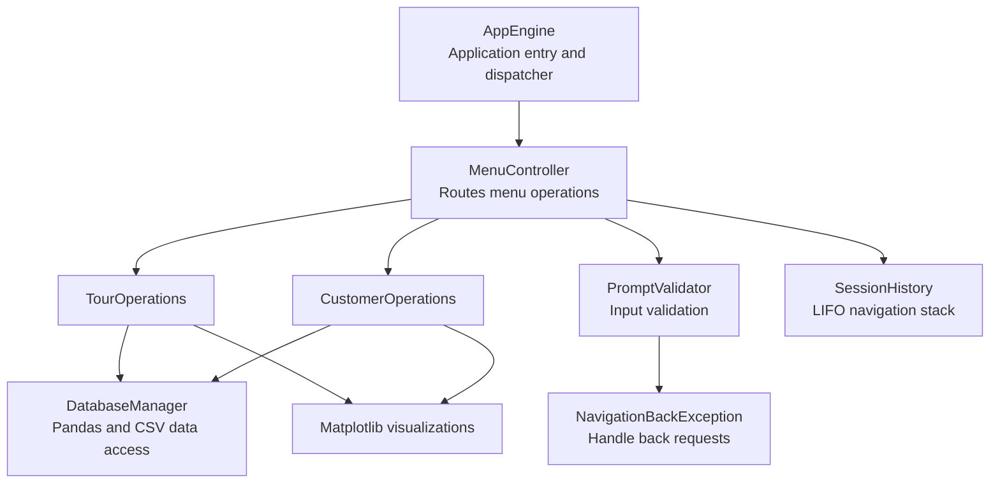

### ✈️ Tour & Travel Management System

A Python command-line application for managing tours, customer records, bookings, and guide information. It combines object-oriented design, CSV-based data handling, stack-based navigation, and data visualization.

<p align="center">
  
  
  
  
</p>

---

## ✨ Features

The application is organized around the main tasks of a travel-management workflow:

| Feature | What it provides |
| --- | --- |
| 🧭 **Tour management** | Access and manage tour records, including destinations, prices, and schedules. |
| 👥 **Customer management** | Maintain customer profiles and access customer-related records. |
| 🎟️ **Booking management** | Work with reservation records and the associations between customers and tour packages. |
| 🗂️ **Menu navigation** | Move between application modules and return to previous menus using a custom history mechanism. |
| 📄 **CSV data management** | Read and write structured datasets with Pandas, keeping each type of record in its own file. |
| 📊 **Visualizations** | Use Matplotlib to explore tour popularity and customer-related data patterns. |

---

## 🏗️ Core Architecture

The system separates data access, navigation, input handling, business operations, and application startup. The diagram shows how those responsibilities fit together.



### Component responsibilities

| Component | Layer | Responsibility |
| --- | --- | --- |
| `AppEngine` | Runtime | Starts the application and dispatches control to the appropriate components. |
| `MenuController` | Control | Provides the base controller and routes menu selections to operations. |
| `TourOperations` | Functional module | Handles tour-related operations and tour visualizations. |
| `CustomerOperations` | Functional module | Handles customer and booking-related operations and visualizations. |
| `DatabaseManager` | Data | Reads and writes CSV data with Pandas and supports record-related operations. |
| `PromptValidator` | Input | Validates user input and supports navigation control through exception handling. |
| `SessionHistory` | Navigation | Maintains menu history with a last-in, first-out (LIFO) stack. |

> **Navigation tip:** Type `back` at a prompt to trigger `NavigationBackException` and return to the previous menu state.

---

## 🧰 Technologies

| Technology | Use |
| --- | --- |
| Python | Application logic |
| Object-oriented programming | Classes, inheritance, and modular organization |
| Pandas | DataFrame operations and CSV management |
| NumPy | Numerical operations |
| Matplotlib | Data visualization |
| CSV | Local structured data storage |

---

## 📊 Data files

The application uses four CSV files to keep its records organized:

| File | Primary key | Contents |
| --- | --- | --- |
| `TOUR.csv` | `Tour_ID` | Tour names, destinations, pricing, and schedules |
| `CUSTOMERS.csv` | `Customer_ID` | Customer profiles and contact information |
| `BOOKING.csv` | `Booking_ID` | Booking records and customer-to-tour associations |
| `GUIDE.csv` | `Guide_ID` | Tour guide information and assignment details |

---

## 📂 Repository structure

```text
Tourism-and-travel-management-system/
├── main_source_code.py
├── TOUR.csv
├── CUSTOMERS.csv
├── BOOKING.csv
├── GUIDE.csv
├── Future updates.md
├── README.md
└── LICENSE
```

---

## ⚙️ Requirements

- Python 3.8 or later
- Pandas
- NumPy
- Matplotlib
- Windows, macOS, or Linux (or Google Colab)

Install the libraries with:

```bash
pip install pandas numpy matplotlib
```

---

## ▶️ Installation and execution

1. Clone the repository:

   ```bash
   git clone https://github.com/shivangichaudhary-cse/Tourism-and-travel-management-system.git
   cd Tourism-and-travel-management-system
   ```

2. Install the dependencies:

   ```bash
   pip install pandas numpy matplotlib
   ```

3. If needed, update the CSV file paths in `main_source_code.py` to match your local setup. Paths such as `/content/` are examples from Google Colab.

4. Start the application:

   ```bash
   python main_source_code.py
   ```

---

## 🧠 Concepts demonstrated

- Object-oriented programming, inheritance, and modular design
- Exception handling and custom navigation exceptions
- Stack data structures and LIFO navigation
- Dynamic method dispatch
- CSV file handling and Pandas DataFrames
- Numerical operations with NumPy and visualizations with Matplotlib

---

## 🔮 Future enhancements

Potential next steps include:

- Replace CSV storage with a relational database such as SQLite or PostgreSQL.
- Build a graphical interface with PySide6 or PyQt.
- Generate booking receipts and customer invoices as PDFs.
- Add role-based access control for administrative and customer operations.

See [Future updates](Future%20updates.md) for additional development notes.

---

## 🔭 Scope and limitations

This project is a local, terminal-based management application. It does not currently include public online booking, payment processing, live flight or hotel API integrations, cloud-hosted database services, or multi-user authentication. These could be considered for future development.

---

## 📜 License

This project is licensed under the MIT License. See [LICENSE](LICENSE) for details.
