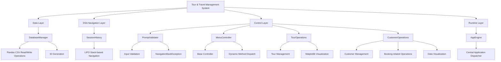

### ✈️ Tour & Travel Management System

A Python-based command-line application designed to manage tour information, customer records, and booking data through a structured and interactive travel management system.

The project explores the practical application of Object-Oriented Programming, custom data structures, structured data handling, and data visualization. It combines modular software design with analytical operations to deliver an interactive travel management experience.

<p align="center">
  
  
  
  
  
</p>

---

## 📌 Project Introduction

The Tour & Travel Management System (TTMS) is an interactive terminal-based application developed in Python to organize and manage essential travel agency operations.

The system works with structured CSV datasets to maintain tour information, customer profiles, booking records, and tour guide details. Through a menu-driven interface, users can navigate between application modules and perform operations on the stored data.

By integrating Object-Oriented Programming principles, custom stack-based navigation, Pandas DataFrames, and Matplotlib visualizations, the project demonstrates how core programming concepts can be combined to build a complete data-oriented application.

> [!NOTE]
> The application is designed for lightweight execution in local Python environments and cloud notebook platforms such as Google Colab.

---

## 🎯 Project Goals

- **Organized Travel Management:** Provide structured operations for managing tours, customers, bookings, and related information.
- **Interactive Navigation:** Implement a menu-driven interface with custom navigation and input validation.
- **Structured Data Handling:** Maintain application records through CSV files and Pandas-based data operations.
- **Data Visualization:** Explore travel-related data through graphical representations and analytical insights.
- **Modular Architecture:** Apply OOP principles, inheritance, and dynamic method dispatch to organize application functionality.
- **Practical DSA Implementation:** Demonstrate stack-based navigation using the Last-In, First-Out (LIFO) principle.

---

## 🚀 Features

### 1. Tour Management

- Access and manage tour-related information.
- Work with tour records containing destinations, pricing, and scheduling details.
- Support tour-related data operations.

### 2. Customer Management

- Store and manage customer profiles.
- Maintain structured customer information.
- Access customer-related records and booking information.

### 3. Booking Management

- Handle booking-related records.
- Maintain associations between customers and tour packages.
- Work with structured reservation data.

### 4. Interactive Navigation

- Navigate through different application modules using a menu-driven interface.
- Implement custom navigation handling.
- Support returning to previous menu states through a dedicated navigation mechanism.

### 5. Data Handling

- Read and write structured CSV datasets.
- Use Pandas for data manipulation and record management.
- Maintain separate datasets for different application entities.

### 6. Data Visualization

- Integrate Matplotlib for graphical data representation.
- Explore tour popularity and customer-related data patterns.
- Support analytical interpretation through visual outputs.

---

## 🛠️ Technologies Used

| Technology | Purpose |
|---|---|
| Python | Core programming language and application logic |
| Object-Oriented Programming | Modular architecture, inheritance, and method organization |
| Pandas | DataFrame operations and CSV data management |
| NumPy | Numerical operations |
| Matplotlib | Data visualization and graphical analysis |
| CSV | Structured file-based data storage |

---

## 📊 Data Collection

The system uses four structured CSV files to store and manage application data.

| File Name | Primary Key | Description |
|---|---|---|
| `TOUR.csv` | `Tour_ID` | Stores tour information, including tour names, destinations, pricing, and schedules. |
| `CUSTOMERS.csv` | `Customer_ID` | Maintains customer profiles, including contact details, addresses, and email information. |
| `BOOKING.csv` | `Booking_ID` | Stores booking records and associations between customers and tour packages. |
| `GUIDE.csv` | `Guide_ID` | Maintains tour guide information and related assignment details. |

These datasets allow the application to organize different categories of information separately while supporting data access and manipulation through Pandas.

---

## 🧠 Methodology & System Architecture

TTMS follows a modular architecture that separates data management, navigation, application control, and runtime execution.

### Architectural Overview



### Core Architectural Components

#### 1. DatabaseManager — Data Layer

Responsible for handling structured data operations through Pandas, including reading and writing CSV files and supporting record-related functionality.

#### 2. SessionHistory — Navigation Layer

Implements a custom stack-based navigation mechanism using the LIFO (Last-In, First-Out) principle to maintain application menu history.

#### 3. PromptValidator — Input Validation

Handles user input validation and supports custom navigation control through exception handling.

#### 4. MenuController — Control Layer

Acts as a base controller for organizing application operations and supporting dynamic method dispatch.

#### 5. TourOperations & CustomerOperations — Functional Modules

Provide dedicated controllers for tour-related and customer-related management operations, with associated data-handling and visualization functionality.

#### 6. AppEngine — Runtime Layer

Coordinates application execution and dispatches control between the different application components.

> [!IMPORTANT]
> The application supports typing `back` at input prompts to initiate custom navigation handling through `NavigationBackException`. This works alongside the LIFO session history mechanism to facilitate menu navigation.

---

## 📂 Repository Structure

```text
Tourism-and-travel-management-system/
├── main_source_code.py
├── TOUR.csv
├── CUSTOMERS.csv
├── BOOKING.csv
├── GUIDE.csv
├── Future updates.md
├── README.md
└── LICENSE
```

---

## ⚙️ System Requirements

### Hardware & Environment

- Operating System: Windows, macOS, or Linux
- RAM: 2 GB minimum recommended
- Storage: Sufficient space for Python, dependencies, and project files
- Execution Environment: Local Python environment or Google Colab

### Software Requirements

- Python: Python 3.8 or higher
- Required Libraries:
  - Pandas
  - NumPy
  - Matplotlib

### Install Dependencies

Install the required Python libraries using pip:

```bash
pip install pandas numpy matplotlib
```

---

## ▶️ Installation & Execution

Follow these steps to run the application:

### 1. Clone or Download the Repository

Download the repository to your local device or clone it using Git:

```bash
git clone https://github.com/shivangichaudhary-cse/Tourism-and-travel-management-system.git
```

### 2. Install Dependencies

Make sure Python and the required libraries are installed:

```bash
pip install pandas numpy matplotlib
```

### 3. Configure CSV File Paths

Update the CSV file paths in `main_source_code.py` according to the location where the project files are stored on your device.

> [!NOTE]
> The file paths currently used in the source code (such as `/content/`) are sample paths from the Google Colab environment. If you are running the application in a different environment, replace them with the appropriate local file paths.

### 4. Run the Application

Navigate to the project directory and execute:

```bash
python main_source_code.py
```

---

## 📚 Concepts Demonstrated

This project demonstrates the practical application of several fundamental programming and Computer Science concepts.

| Concept | Application in the Project |
|---|---|
| Object-Oriented Programming (OOP) | Organizing application components into classes |
| Inheritance | Establishing relationships between controller classes |
| Exception Handling | Managing invalid inputs and custom navigation flow |
| Custom Exceptions | Implementing `NavigationBackException` |
| Stack Data Structure | Maintaining navigation history using LIFO |
| Dynamic Method Dispatch | Supporting controller-level operation routing |
| CSV File Handling | Reading and writing structured datasets |
| Pandas DataFrames | Managing and manipulating application records |
| NumPy | Supporting numerical operations |
| Matplotlib | Generating data visualizations |
| Modular Programming | Separating application responsibilities into logical components |

---

## 🔮 Future Scope & Enhancements

The project can be extended through several improvements to enhance its functionality, usability, and data management capabilities.

### 1. SQL Relational Database Integration

- Replace CSV-based storage with a relational database such as SQLite or PostgreSQL.
- Introduce structured database relationships and query-based operations.
- Improve transaction management and data consistency.

### 2. Graphical User Interface (GUI)

- Transition from terminal-based navigation to a graphical desktop application.
- Explore frameworks such as PySide6 or PyQt.
- Develop interactive dashboards for tour and customer management.

### 3. Automated PDF Invoicing

- Generate booking receipts and customer invoices automatically.
- Create downloadable financial summaries and transaction reports.

### 4. Role-Based Access Control (RBAC)

- Introduce separate access levels for administrators and customers.
- Restrict administrative operations such as adding, modifying, or removing tour records.
- Improve application-level access management.

> [!TIP]
> More planned improvements and detailed future development notes are maintained separately.
>
> [View Future Updates](Future%20updates.md)

---

## 🔭 Project Scope & Limitations

### Primary Scope

The current project focuses on providing a structured, terminal-based management application for organizing tour information, customer records, booking data, and related travel agency information.

It demonstrates how Python programming, OOP architecture, custom data structures, and data analysis libraries can be integrated into a single application.

### Current Limitations

The present implementation focuses on local, file-based management rather than a fully deployed online travel platform.

The following functionalities are outside the current implementation scope:

- Public-facing online booking portals.
- Integrated payment gateways.
- Live flight and hotel API synchronization.
- Cloud-hosted database services.
- Multi-user authentication and access management.

These areas may be considered for future development.

---

## 💡 Conclusion

The Tour & Travel Management System demonstrates how fundamental Computer Science concepts can be applied to develop a structured and interactive management application.

By combining Object-Oriented Programming, inheritance, custom exception handling, stack-based navigation, CSV file management, Pandas DataFrames, and Matplotlib visualization, the project explores practical software design principles.

Beyond its core management functionality, the modular architecture provides a foundation for future enhancements, including relational database integration, graphical interfaces, automated reporting, and role-based access control.

The project serves as a practical exploration of Python programming, software architecture, data structures, and analytical tools through a domain-oriented application.

---

## 📜 License

This project is licensed under the MIT License.

See the [LICENSE](LICENSE) file for complete license details.
