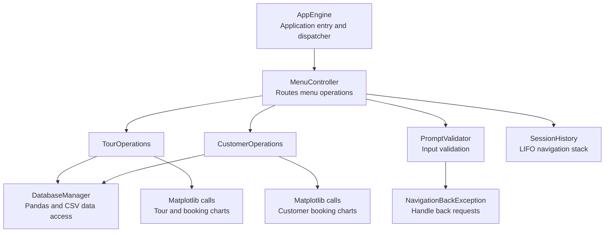

### ✈️ Tour & Travel Management System

A Python command-line application for managing tours, customer records, bookings, and guide information. It combines object-oriented design, CSV-based data handling, stack-based navigation, and data visualization to demonstrate a complete desktop-style data-management workflow.

<p align="center">
  
  
  
  
</p>

---

## 🎯 Project Overview / Objective

Managing tour packages, customer profiles, and reservations through disconnected records can make it difficult to keep information consistent and to identify booking trends. This project provides a single Python command-line system that organizes those records and gives the user basic tools to add, update, review, and remove data.

The project's objective is to demonstrate how core software-development concepts can be combined in a practical management application: modular object-oriented design, CSV-backed persistent storage, validated interactive input, menu history, and exploratory data visualization. It also provides a focused learning environment for understanding how identifiers and separate datasets are related—for example, how a `Customer_ID` and `Tour_ID` in `BOOKING.csv` connect customer and tour records.

---

## ✨ Features

The application is organized around the main tasks of a travel-management workflow:

| Feature | What it provides |
| --- | --- |
| **Tour management** | Access and manage tour records, including destinations, prices, and schedules. |
| **Customer management** | Maintain customer profiles and access customer-related records. |
| **Booking management** | Work with reservation records and the associations between customers and tour packages. |
| **Guide records** | Load and retain guide information and its tour assignments. |
| **Menu navigation** | Move between application modules and return to previous menus using a custom history mechanism. |
| **CSV data management** | Read and write structured datasets with Pandas, keeping each type of record in its own file. |
| **Visualizations** | Use Matplotlib to explore tour demand and customer booking patterns. |

---

## 🏗️ Core Architecture

The application separates runtime control, menu dispatch, operation classes, validation, navigation, and data access.



### Component responsibilities

| Component | Layer | Responsibility |
| --- | --- | --- |
| `AppEngine` | Runtime | Creates the controller modules, starts the main menu, and tracks module history. |
| `MenuController` | Control | Provides the common menu loop, dynamic dispatch map, choice handling, and back-navigation exception handling. |
| `TourOperations` | Functional module | Manages tour CRUD actions, popularity, availability, budgeting, and tour-related charts. |
| `CustomerOperations` | Functional module | Manages customer CRUD actions and displays a customer's booking history as a chart. |
| `DatabaseManager` | Data | Loads all four CSV files into indexed Pandas DataFrames and saves modified DataFrames. |
| `PromptValidator` | Input | Validates command-line input and recognizes `back` as a navigation request. |
| `SessionHistory` | Navigation | Maintains module history with a last-in, first-out (LIFO) stack. |

Both functional modules extend `MenuController`, use `PromptValidator` for interactive input, and access the shared `db` instance. They also generate charts directly with Matplotlib rather than using a separate chart service: `TourOperations` draws tour-popularity, availability, and budget charts, while `CustomerOperations` draws a booking-history chart for a selected customer. This direct, module-level visualization flow is consistent in both classes even though their chart data differs.

> **Navigation tip:** Type `back` at a prompt to trigger `NavigationBackException` and return to the previous menu state.

---

## 🧰 Technologies

| Technology | Use |
| --- | --- |
| Python | Application logic |
| Object-oriented programming | Classes, inheritance, and modular organization |
| Pandas | DataFrame operations and CSV management |
| NumPy | Numerical operations |
| Matplotlib | Data visualization |
| CSV | Local structured data storage |

---

## 📊 Data Handling

`DatabaseManager` loads `TOUR.csv`, `CUSTOMERS.csv`, `BOOKING.csv`, and `GUIDE.csv` once when the application starts. Pandas reads each file into a DataFrame and uses its ID column as the index, such as `Tour_ID` or `Customer_ID`; missing values are replaced with empty strings.

The datasets are linked through shared identifiers:

| File | Primary key | Contents and role |
| --- | --- | --- |
| `TOUR.csv` | `Tour_ID` | Tour names, destinations, prices, and start/end dates; used for tour operations and charts. |
| `CUSTOMERS.csv` | `Customer_ID` | Customer names and contact details; used for customer profiles. |
| `BOOKING.csv` | `Booking_ID` | Booking dates plus `Customer_ID` and `Tour_ID`; connects customers to tour packages and supports popularity analysis. |
| `GUIDE.csv` | `Guide_ID` | Guide names, contact information, and assigned `Tour_ID` values. |

The application creates or updates DataFrames in memory, then writes them back to CSV files through `DatabaseManager.save()`. The current source uses `/content/` only for initial reads and writes some modified files to names such as `Tours.csv` and `Customers.csv`; when running locally, these paths and filenames should be verified and kept consistent with the repository CSV files.

---

## 📂 Repository structure

```text
Tourism-and-travel-management-system/
├── main_source_code.py
├── TOUR.csv
├── CUSTOMERS.csv
├── BOOKING.csv
├── GUIDE.csv
├── Future updates.md
├── README.md
└── LICENSE
```

---

## ⚙️ Requirements

- Python 3.8 or later
- Pandas
- NumPy
- Matplotlib
- Windows, macOS, or Linux (or Google Colab)

Install the libraries with:

```bash
pip install pandas numpy matplotlib
```

---

## ▶️ Installation and execution

1. Clone the repository:

   ```bash
   git clone https://github.com/shivangichaudhary-cse/Tourism-and-travel-management-system.git
   cd Tourism-and-travel-management-system
   ```

2. Install the dependencies:

   ```bash
   pip install pandas numpy matplotlib
   ```

3. If needed, update the CSV file paths in `main_source_code.py` to match your local setup. Paths such as `/content/` are examples from Google Colab.

4. Start the application:

   ```bash
   python main_source_code.py
   ```

---

## 🧠 Concepts demonstrated

- Object-oriented programming, inheritance, and modular design
- Exception handling and custom navigation exceptions
- Stack data structures and LIFO navigation
- Dynamic method dispatch
- CSV file handling and Pandas DataFrames
- Numerical operations with NumPy and visualizations with Matplotlib

---

## 🔮 Future enhancements

Potential next steps include:

- Replace CSV storage with a relational database such as SQLite or PostgreSQL.
- Build a graphical interface with PySide6 or PyQt.
- Generate booking receipts and customer invoices as PDFs.
- Add role-based access control for administrative and customer operations.

See [Future updates](Future%20updates.md) for additional development notes.

---

## 🔭 Scope and limitations

This project is a local, terminal-based management application. It does not currently include public online booking, payment processing, live flight or hotel API integrations, cloud-hosted database storage, or concurrent multi-user support. The CSV files provide simple persistence but may require extra safeguards and relational database features as the dataset grows.

---

## ✅ Conclusion

The Tour & Travel Management System brings several Python programming concepts together in a small, understandable application. It demonstrates how object-oriented controllers can organize an interactive workflow, how a shared data layer can maintain CSV-backed records, and how menu navigation can be controlled with exceptions and a stack. Matplotlib charts extend the system beyond record maintenance by turning booking and tour data into visual summaries.

The project also illustrates a key transition between learning projects and larger systems: simple CSV files are easy to inspect and maintain for a prototype, while future growth would benefit from a relational database, stronger validation, and a graphical or web interface.

---

## 📜 License

This project is licensed under the MIT License. See [LICENSE](LICENSE) for details.
